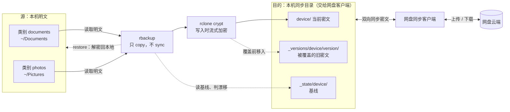

# rbackup

> **一句话**：rbackup 把本地明文目录经 rclone crypt 流式加密后，以“只复制、不镜像”的方式增量写入本机的网盘同步目录，再由任意网盘客户端带到云端——不用自建服务端、不维护文件索引、不绑定特定网盘，却能按设备隔离、覆盖留档，并且永不静默覆盖远端变化。

rbackup 面向“已经有网盘，但不愿把明文交给网盘，也不想为备份再维护一套服务器”的场景。它把信任集中在一件事上——保管好 rclone crypt 的密码。

**三个角色**

| 角色 | 是什么 | 里面有什么 |
|---|---|---|
| **源** | 要备份的本地明文目录，按“类别”配置 | 原件；零密文、零索引、零镜像 |
| **目的** | 本机上一个交给网盘客户端同步的目录 | 密文当前版本、`_versions`、`_state` |
| **网盘** | 由网盘客户端负责的云端 | 目的目录的一份同步副本 |

三者的关系，以及目的里为什么还会多出 `_versions`、`_state`：



`device/` 是设备前缀，一台设备只写自己那一份；`_versions`、`_state` 同样在目的里，会随目的一起上云。除了 `restore`，没有从目的回到源的反向路径。

全文统一用“源”“目的”指代两端。目的目录本身在本地，只是它的内容会被同步上云。

**它不做什么**：不合并冲突、不传播删除、不做块级去重、不替代网盘客户端。

**四条硬规则**

1. **只 `copy`，绝不 `sync`**：源删除文件不会导致目的删除；目的多出的文件也不会被自动清理。
2. **一设备一前缀**：设备只写 `<remote>:<device>/`，不同设备互不干扰。
3. **覆盖必留版本**：旧密文在目的内移入 `_versions/<device>/<version>/<类别>`，随后由同步客户端上传。**删除不产生版本**——删掉的东西在 `_versions` 里找不到。
4. **目的漂移不静默覆盖**：`backup` 发现目的相对 `_state` 基线变化时默认退出码 3，必须检查后加 `--force`。

## 安装

需要 Python **3.11+** 和 **rclone**。rbackup 不捆绑 rclone，请先自己装好：

- 从 <https://rclone.org/install/> 下载并安装（Windows 解压即用，macOS 用 Homebrew 或脚本，Linux 用脚本或包管理器）；
- 装完运行 `rclone version` 确认可用，并保证 `rclone` 在 `PATH` 上；不在 `PATH` 上时，在配置里给 `rclone_bin` 写绝对路径。

然后安装 rbackup 本体：

```bash
pip install rbackup             # 从 PyPI 安装
python -m pip install -U rbackup   # 升级
```

项目页：<https://pypi.org/project/rbackup/>。

从源码开发时：

```bash
pip install -e .        # 安装后可用 rbackup 命令
python -m rbackup ...   # 也可以直接在项目目录这样用
```

## 最小上手

```bash
rbackup web             # 1. 打开配置页，填设备名、crypt remote、类别目录；点“保存配置”
rbackup doctor          # 2. 检查配置、目的路径、加密边界
rbackup backup --dry-run   # 3. 先看计划
rbackup backup             # 4. 正式备份
rbackup status             # 5. 看基线与漂移
```

日常备份、清空本地、换机恢复、多设备共存这些场景，以及图形化的对比/上传/删除/恢复，见下面的文档。

两件与“可追溯”有关的事：

- 删除、恢复、上传、重设基线、保存配置都会往 `<配置>.audit.log` 追加一条审计记录，用 `rbackup audit` 查看；
- 每次保存配置都会把旧配置留档到 `<配置>.backups/`（保留 20 份），用 `rbackup config-backup` 查看或恢复。

## 文档

| 文档 | 内容 |
|---|---|
| [概念与模型](docs/01-概念与模型.md) | 数据流、目的的目录布局、三种部署形态 |
| [典型场景](docs/02-典型场景.md) | 日常增量、清空本地、目的漂移、多设备、灾难恢复、用户决策流程 |
| [约束与安全](docs/03-约束与安全.md) | 四条硬规则、部署边界、一致性与并发、安全边界与已知限制 |
| [实现细节](docs/04-实现细节.md) | 一次 backup 的时序、与 rclone 的边界、基线与漂移判定、watch 轮询、状态文件示例 |
| [安装与配置](docs/05-安装与配置.md) | 准备目的目录、创建 crypt remote、完整配置项说明 |
| [快速开始与管理页](docs/06-快速开始与管理页.md) | 命令速查、Web 配置页、对比与操作页（上传/删除/恢复/进度） |
| [命令参考](docs/07-命令参考.md) | backup / watch / status / diff / verify / versions / prune / restore，密文与删除，退出码 |
| [运维与开发](docs/08-运维与开发.md) | 定时运行与同步、开发与测试 |

## 退出码

| 退出码 | 含义 |
|---|---|
| `0` | 成功 |
| `1` | rclone/传输/状态读写失败，或有本地类别缺失，或同设备已有进程在运行 |
| `2` | 配置/用法错误 |
| `3` | 目的相对状态基线漂移且未加 `--force`；或 `--check` 发现差异 |
| `4` | `cryptcheck` 未通过（上传可能已成功） |
| `130` | Ctrl+C 中断 |

细节见 [命令参考 · 退出码](docs/07-命令参考.md#11-退出码)。

## 许可

见 [LICENSE](LICENSE)。
