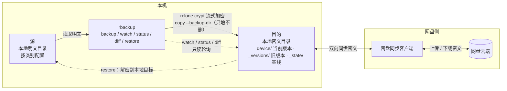

# rbackup

> **一句话**：rbackup 把本地明文目录经 rclone crypt 流式加密后，以“只复制、不镜像”的方式增量写入本机的网盘同步目录，再由任意网盘客户端带到云端——不用自建服务端、不维护文件索引、不绑定特定网盘，却能按设备隔离、覆盖留档，并且永不静默覆盖远端变化。

rbackup 面向“已经有网盘，但不愿把明文交给网盘，也不想为备份再维护一套服务器”的场景。它不是同步工具，也不是网盘客户端：不合并冲突、不传播删除、不做块级去重。它把信任集中在一件事上——保管好 rclone crypt 的密码。

**三个角色**

| 角色 | 是什么 | 里面有什么 |
|---|---|---|
| **源** | 要备份的本地明文目录，按“类别”配置 | 原件；零密文、零索引、零镜像 |
| **目的** | 本机上一个交给网盘客户端同步的目录 | 密文当前版本、`_versions`、`_state` |
| **网盘** | 由网盘客户端负责的云端 | 目的目录的一份同步副本 |

下文统一用“源”“目的”指代两端。目的目录本身在本地，只是它的内容会被同步上云。

## 1. 工作模型



图里只有四条关键关系：

1. **源 → 目的**：rbackup 调用 `rclone copy`，crypt remote 在写入时完成加密，不落地中间明文或临时密文。
2. **目的 ↔ 网盘**：完全由网盘客户端负责。rbackup 不直接调用网盘 API，也不关心是哪家网盘。
3. **目的 → rbackup**：`watch` / `status` / `diff` 只读目的，发现变化只报告，不自动处理。
4. **目的 → 源**：唯一的反向路径是 `restore`，必须由人显式触发；没有任何自动合并。

因为目的在本地，rbackup 的读、写、校验都是本地文件系统操作，速度和费用与网盘无关；代价是密文、版本和状态会占用目的所在的磁盘。

### 1.1 目的里的布局

假设 rclone crypt remote `b_crypt` 的底层是 `D:/QuarkSync/rbackup`：

```text
D:/QuarkSync/rbackup/                 # 目的，本地同步目录
├── <device>/
│   ├── documents/                    # 当前版本（密文）
│   └── photos/
├── _versions/
│   └── <device>/
│       └── 20261030T235653Z-a1b2c3/
│           ├── documents/            # 被覆盖的旧文件
│           └── photos/
└── _state/
    └── <device>/
        └── last-run.json             # rclone rcat 写入的基线
```

说明：

- `<device>` 是设备前缀。设备只写自己的 `<device>/`，不同设备互不干扰。
- `<version>` 使用 UTC 时间 `YYYYMMDDTHHMMSSZ-<6位随机>`，同一秒运行也不会冲突。
- 状态放在 `_state/<device>/` 而不是全局 `_state/last-run.json`，是为了遵守“一设备一前缀”，避免两台设备互相覆盖状态。
- `_state` 只记录设备、版本、每类文件数/字节数/摘要，不保存文件清单。
- **目的在本地，所以 `_versions` 和 `_state` 会占用目的所在磁盘。** 这是“目的是本地同步目录”的必然结果；它们会随目的同步到云端。源本身仍然没有密文、索引或镜像。
- 如果严格要求版本“完全不落本地”，只能让 crypt remote 直接指向云端，而不是本地目的目录；那是另一种部署形态，见 [3.2](#32-部署与同步边界)。
- 目的里看到的都是密文名（目录名同样加密）；如何还原成明文、如何按明文路径删除，见 [8.7](#87-查看密文对应的明文以及删除目的中的数据)。

### 1.2 三种部署形态

| 形态 | 目的在哪 | 版本与状态 | 适用 |
|---|---|---|---|
| 本机同步目录（推荐） | 本机磁盘 | 随目的上云 | 绝大多数情况 |
| 另一块磁盘 / 另一台机器 | 挂载的本地路径 | 随目的上云 | 想避免本机落密文 |
| crypt remote 直接指向云端 | 云端 | 不落本地 | 本机不能有任何密文 |

前两种形态下，rbackup 能自动识别目的路径并校验；第三种形态下 `b_path` 为空，`_versions` 和 `_state` 直接写在云端，恢复和版本操作照常，但每次都要走网络。

## 2. 典型场景

以下命令省略 `--config`；配置查找顺序见 [7. 配置说明](#7-配置说明)。

### 2.1 日常增量备份

```bash
rbackup backup
```

只有新增或变化的文件会被写入目的；被覆盖的旧内容进入 `_versions/<device>/<version>/<类别>/`，随目的一起上云。源里删掉的文件不会导致目的删除，这是备份工具应有的行为。

### 2.2 清空本地，但把备份留在云端

平时用 Web 操作页的“从源删除”：它只删本机明文，目的和云端原样保留，`_state` 基线也不受影响。之后这些文件在对比里变成“只在目的”，随时可以 `restore` 回来。

如果连目的也想删（例如确认永久不再需要），再按 [8.7](#87-查看密文对应的明文以及删除目的中的数据) 操作——那一步会同步到云端，不可逆。

### 2.3 云端或目的发生变化

网盘客户端从云端拉回的新文件、另一台设备的误写、手工改动，都会让目的偏离 `_state` 基线。处理方式是“先看清，再选择”：

```text
watch 报告 / status --check 发现漂移
        │
        ├─ diff 看清楚：目的新增了什么、改了什么、源删除了什么
        │
        ├─ 想保留目的的变化 → restore（可先到 staging 目录）
        │
        ├─ 想用源覆盖目的 → backup --force（目的旧内容自动进 _versions）
        │
        └─ 暂时不处理 → 忽略；漂移会继续显示，不会被静默吞掉
```

默认的 `backup` 遇到漂移会以退出码 3 拒绝写入，只有 `--force`（或终端里明确确认）才会覆盖。

### 2.4 多台设备共用一个网盘

每台设备配置不同的 `device`，各自只写 `<device>/`；`_versions/<device>/` 与 `_state/<device>/` 也彼此隔离。任何一台设备都看不到、也不会改另一台设备的备份。

同一个 `device` 只允许一台机器写入。状态文件里记了 `hostname`，主机不一致时 `backup` 会警告，`doctor` 会报告 `device_identity` 检查失败。

### 2.5 换机、误删与灾难恢复

- 单文件、整个类别、某个历史版本都可以恢复，方向是 **目的 → 本地**，经 crypt 解密，与 `backup` 正好相反。
- 推荐先恢复到空的暂存目录，比对无误后再归位，不要一步覆盖源。
- 目的本机目录丢失时，先让网盘客户端把云端数据完整同步回目的（确认 `_state`、`<device>`、`_versions` 都在），再执行恢复。
- 详见 [8.6](#86-restore把备份恢复回来)。

### 2.6 只想先看看会发生什么

```bash
rbackup doctor                  # 环境、remote 类型、目的路径、目录、状态
rbackup backup --dry-run        # 只打印 rclone 计划，不写数据
rbackup diff                    # 源与目的当前版本的差异
rbackup status                  # 基线是否漂移
```

`--dry-run` 不写目的、不写状态；`diff` / `status` / `verify` 都不写数据。

## 3. 约束

### 3.1 四条硬规则

1. **只 `copy`，绝不 `sync`**：源删除文件不会导致目的删除；目的多出的文件也不会被自动清理。
2. **一设备一前缀**：设备只写 `b_crypt:<device>/`，不同设备互不干扰。
3. **覆盖必留版本**：`rclone copy --backup-dir b_crypt:_versions/<device>/<version>/<类别>`，旧密文在目的内移动，随后由同步客户端上传。
4. **目的漂移不静默覆盖**：`backup` 发现目的相对 `_state` 基线变化时，默认退出码 3；必须检查后加 `--force` 才覆盖。

“只 copy”的代价要提前接受：目的不会自动变干净。删除备份数据（目的或历史版本）的入口只有 Web 操作页的“从目的删除”和 `prune`，都要人工确认；“从源删除”只删本地明文，不碰备份。

### 3.2 部署与同步边界

- **源与目的不能相同，也不能互相嵌套**。工具在启动和 `doctor` 时检查并拒绝：
  - 目的在源内：rclone 会把目的的密文再次备份进自己，可能递归；
  - 源在目的内：同步客户端会把源的明文也上传，破坏加密边界。
- **网盘客户端只能同步目的**。不要把源目录也放进同一个同步范围，否则明文直接上云。
- **`restore` 的目标不能指向目的**：那会把明文写进密文区，破坏备份。
- 源、目的都要是本地可访问的目录；目的不存在时工具拒绝运行（网盘客户端没启动、盘没挂载都会触发）。
- 类别名会成为目的内的目录名，允许中文和内部空格，但不能含 `/ \ : * ? " < > |`，不能以 `.` 结尾；设备名同理（最长 64 字符）。
- `state_prefix`、`versions_prefix` 只能是单层目录名，不能相同，也不能与 `device` 或 remote 同名。

### 3.3 一致性与并发

- 没有跨文件事务。传输中断时已传部分会保留，重跑 `backup` 会继续补齐；状态可能仍是旧基线，下次会提示漂移。
- 漂移检测基于“路径 + 大小 + mtime”。目的内容被改但大小和 mtime 完全不变时，轮询发现不了，需要 `verify` 做内容校验。
- `rclone copy` 默认也按大小 + mtime 判断是否传输。源文件内容变了但大小和 mtime 都没变时，备份可能跳过它；可 `touch` 一下，或把这类数据单独成类并定期 `verify`。
- 同一设备的 `backup` / `prune` 有本地进程锁，防止并发；`watch` / `restore` / Web 页的单项上传或删除不加锁，可能看到传输中的中间状态。
- `_state` 是唯一的基线。删掉它，`backup` 会把目的判为“有数据但无基线”并拒绝覆盖，需要重新 `--force` 建立信任。

### 3.4 安全边界

- **crypt 密码是唯一单点故障**：密码或 `rclone.conf` 丢失，目的和云端的数据都无法恢复。
- `rbackup` 不把密码写进自己的配置或状态；它只调用 rclone，读 remote 配置时只看 `type` 和底层 `remote`。
- 目的里有密文、版本和状态；源里没有密文、索引或镜像。所谓“零密文”指源所在目录，不是整台机器。
- 状态文件只有设备名、类别计数和摘要，没有文件清单；但目的内的目录结构/文件名是否可见取决于 crypt 的 `filename_encryption` 设置。
- **Web 的“从源删除”直接 `unlink`/`rmtree`，不经过系统回收站**；确认框是最后一道保险。
- 网盘客户端冲突时可能生成“冲突副本”。crypt 文件名被追加后缀后，rclone 可能无法解密；因此同一 `<device>` 前缀只应由一台设备写入。
- 命令日志可能包含本地路径和目的路径，注意日志权限。

## 4. 实现细节

### 4.1 一次 backup 的时序

1. **构造 App**：读取 rclone remote 配置，确认 `type = crypt`；如果底层是本地绝对路径，规范化成 `b_path`，检查存在、是目录、且不与任何类别目录嵌套。
2. **加锁**：以 `remote|device` 为键在系统临时目录加跨进程锁；拿不到锁直接报错。
3. **读基线**：`rclone cat` 读取 `_state/<device>/last-run.json`；校验 schema、`device`、`remote` 与当前配置一致。
4. **备份前快照**：对本设备前缀做一次 `lsjson -R --files-only`，按类别计算摘要，与基线比较，得到漂移。
5. **漂移决策**：有漂移则打印类别级摘要；终端交互时询问，非交互或 `--json` 直接退出 3，`--force` 跳过询问。没有基线但目的已有数据时，同样视为需要确认。
6. **逐类复制**：对每个存在的类别执行 `rclone copy`，`--backup-dir` 指向本次版本目录，带上排除规则和 `--create-empty-src-dirs`（可配置）。
7. **备份后快照**：重新列举目的，用**目的的实际内容**重算每类的文件数、字节数和摘要，而不是用本地文件数。
8. **写状态**：用 `rclone rcat --size <字节数>` 把新的 `last-run.json` 写回目的；写失败会报 `StateError`，但上传本身已经完成。

`--verify` 会在每类复制后追加一次 `rclone cryptcheck --one-way`；校验失败不撤销上传，退出码为 4。

### 4.2 与 rclone 的边界

所有 rclone 调用都走参数数组，不经过 shell；全局参数统一注入，调用方只拼子命令参数：

| 用途 | 实际调用 |
|---|---|
| 目的快照 | `lsjson -R --files-only --no-mimetype <remote>:<device>` |
| 读取状态 | `cat <remote>:_state/<device>/last-run.json` |
| 写入状态 | `rcat --size <N> <remote>:_state/<device>/last-run.json` |
| 备份 | `copy --backup-dir <remote>:_versions/<device>/<vid>/<类别> [--exclude=…] <源类别目录> <remote>:<device>/<类别>` |
| 校验 | `cryptcheck --one-way <源类别目录> <remote>:<device>/<类别>` |
| 恢复 | `copy`（目录）或 `copyto`（单文件），目标为本地路径 |
| 列历史版本 | `lsjson --dirs-only <remote>:_versions/<device>` |
| 清理版本 | `purge <remote>:_versions/<device>/<vid>` |
| 从目的删除 | `deletefile`（文件）或 `purge`（目录） |

全局参数包括 `--retries`、`--low-level-retries 10`、`--contimeout 30s`、`--timeout 5m`、`--checkers`、`--transfers`，可选 `--bwlimit`，以及符号链接策略（默认 `--links`，`follow_symlinks = true` 时改为 `--copy-links`）。默认 `--stats 0` 关掉进度噪声；`copy`/`copyto` 改为流式执行，进度直接给终端。

rclone 进程继承当前环境，并设置 `RCLONE_ASK_PASSWORD=false`，避免在无人值守时卡在密码提示。错误输出保留尾部 6000 字符，足够定位问题又不淹没日志。

### 4.3 基线与漂移判定

`digest` 是“类别内路径 + 大小 + mtime”的 SHA-256，不含文件内容：

```text
digest = SHA-256( 对每个文件按路径排序:
    category \0 path \0 size \0 mtime \n )
```

- 基线只存摘要和计数，所以状态文件很小，且不需要在本地维护文件清单。
- 比较发生在**目的**的两次快照之间，因此网盘客户端写入目的的变化也能被发现。
- mtime 比较允许约 2–3 秒误差，吸收不同文件系统/后端的精度差异；`diff` 和 Web 对比使用 3 秒，状态摘要使用 rclone 返回的原始字符串。
- 上传后重算摘要，因此“复制成功但状态没更新”不会被误判成一致。

### 4.4 watch 的轮询

`watch` 每隔 `--interval` 秒（默认取配置，最低 1 秒）递归列出本设备前缀，在内存中与上一份快照比较，输出 JSONL 事件：

- `baseline`：监听开始时的概况；
- `drift`：启动时发现目的与 `_state` 基线不同（只到类别级，具体差异用 `diff`）；
- `batch`：运行期间检测到新增/修改/删除；
- `error`：轮询失败，带连续失败次数。

轮询失败不会退出，而是指数退避重试（最长 300 秒）。变化只报告；`--interactive` 才在终端询问 `r`（恢复到暂存目录）、`u`（用源覆盖）、`i`（忽略）、`q`（退出）。`--exit-on-change` 在第一批变化后返回，适合接通知脚本或 CI。

### 4.5 校验与恢复

- `verify` 用 `rclone cryptcheck`：rclone 把源的每个文件用目的中的 nonce 加密后比较校验和，不需要把目的文件完整读回再解密。目的底层是本地文件系统时支持 checksum，因此校验很直接。
- `restore` 先把用户给的相对路径规范化：拒绝绝对路径、盘符和 `..`，防止写到目标目录之外；目录恢复到非空目标必须加 `--force`；单文件目标已存在也必须 `--force`。
- 恢复是 `copy`/`copyto`，不会删除目标目录中多出的文件，也不是跨文件事务；中断后重跑即可补齐。

### 4.6 Web 配置页

`rbackup web` 用标准库 `ThreadingHTTPServer` 只监听 `127.0.0.1`，随机令牌放在 URL 里：

- 页面和 API 都校验令牌（`hmac.compare_digest`），POST 额外校验 `Origin`，不启用 CORS；
- 响应带 `Cache-Control: no-store` 和 CSP，页面无外部 CDN/字体依赖，可离线使用；
- 不执行任意 shell：所有操作都走配置校验器和 rclone 参数数组；
- “对比与操作”用页面当前填写的配置重新构造 App（不必先保存），因此预览行为与保存后一致；
- 保存配置时先写临时文件并用正式加载器校验，再 `os.replace` 原子替换，旧文件备份为 `config.toml.bak`；
- 上传走 `copy`/`copyto --backup-dir`，从目的删除走 `deletefile`/`purge`，两者都会让基线过期并返回 `state_stale`；
- 从源删除只动本地明文（`unlink`/`rmtree`），不动目的、不改基线；删除前会把解析后的真实路径再校验一次必须在源目录内，防止符号链接把删除带到源之外。

### 4.7 并发锁

锁文件放在系统临时目录：`rbackup-<sha256(remote|device)[:16]>.lock`，Windows 用 `msvcrt.locking`，其他系统用 `fcntl.flock`，非阻塞获取，拿不到就报“另一个 rbackup 进程正在使用同一设备”。锁只保护 `backup` 和 `prune`；`watch`、`restore` 和 Web 页的单项上传/删除不加锁。

## 5. 安装与准备

要求：

- Python **3.11+**（标准库 `tomllib`，无第三方 Python 依赖）。
- rclone **1.60+**，并已在 `PATH` 中，或在配置里写绝对路径。
- 一个本地目录作为目的，由网盘客户端同步到云端。
- 一个底层指向目的的 rclone **crypt** remote。

```bash
python -m pip install -e .
# 或者不安装，直接在项目目录：
python -m rbackup --help
```

### 5.1 创建目的目录和网盘同步

1. 创建目的目录，例如 `D:/QuarkSync/rbackup`。
2. 在网盘客户端中把该目录设置为同步目录，确认 目的 → 云端 的同步正常。
3. **目的不能放在源的类别目录里面，源也不能放在目的里面**。工具会检查并拒绝嵌套路径：
   - 目的在源内：rclone 会把目的的密文再次备份进自己，可能递归；
   - 源在目的内：同步客户端会把源的明文也上传，破坏加密边界。

### 5.2 配置 crypt remote

注意：这里 crypt remote 的 `remote` 指向 **目的目录的绝对路径**，不是网盘云端路径。云端同步由网盘客户端负责。使用绝对路径，工具才能自动识别并校验目的。

```bash
rclone config
# n -> 名称 b_crypt -> 类型 crypt
# remote = D:/QuarkSync/rbackup
# filename_encryption = standard
# directory_name_encryption = true
# password / password2 自行设置并妥善保存
```

`b_crypt` 只是示例名字，可以自取，只要和配置里的 `remote` 一致。验证：

```bash
rclone lsd b_crypt:
```

> **非常重要**：crypt 的密码和 `rclone.conf` 丢失后，云端数据无法恢复。请把密码/`rclone.conf` 放到密码管理器或离线安全位置。`rclone.conf` 里的密码只是“混淆”，不是强加密；必要时启用 rclone 的配置加密。启用后请设置 `RCLONE_CONFIG_PASS` 环境变量，`rbackup` 会继承它。

## 6. 快速开始

推荐先用配置页面，再回到终端执行备份：

```bash
# 启动本地配置页（只监听 127.0.0.1，会打印带令牌的 URL）
rbackup web

# 或指定配置文件
rbackup web --config "配置路径" --port 8765
```

页面中填写设备名、crypt remote、源类别，确认自动检测出的目的路径，点“检查配置”，通过后“保存配置”。之后：

```bash
# 如果不用页面，也可以用 init 生成模板再编辑（Windows 默认 %APPDATA%\rbackup\config.toml）
# rbackup init --device my-laptop --remote b_crypt

# 1. 检查配置
rbackup --config "配置路径" doctor

# 2. 先看计划
rbackup --config "配置路径" backup --dry-run

# 3. 正式备份
rbackup --config "配置路径" backup

# 4. 监听目的的变化（只报告，不自动处理）
rbackup --config "配置路径" watch --interval 5

# 5. 需要时把备份恢复回来（详见 8.6）
rbackup --config "配置路径" restore documents --dest ./restore-docs
```

`init` 只生成配置，不会创建 rclone remote，也不会向目的或云端写数据。

除 `init`、`web`、`doctor` 外的命令会先读取 `rclone config show <remote>` 的 `type`；如果不是 `crypt`，直接拒绝执行，避免把明文误传到目的。因此 `remote` 要填**直接的 crypt remote**，不要填 alias。

如果 crypt remote 的底层是本机绝对路径，工具会自动识别目的，并在 `doctor` 中检查它存在、是目录、且与源不嵌套。

### 6.1 配置页面

```bash
rbackup web
# 指定端口 / 不自动打开浏览器
rbackup web --port 8765 --no-browser
```

启动后终端会打印类似：

```text
rbackup 配置页：http://127.0.0.1:50483/?token=......
配置文件：C:\Users\you\AppData\Roaming\rbackup\config.toml
```

页面功能：

- 编辑设备名、crypt remote、rclone 可执行文件/配置路径；
- 从 rclone 读取 remote 列表，检测 remote 类型和底层目的路径；
- 动态增删数据类别、源目录、排除规则、启用状态；
- 编辑轮询间隔、并发、限速、状态/版本前缀、保留版本数、符号链接等高级项；
- **检查配置**：验证 TOML、crypt 类型、目的存在、源/目的不嵌套、类别目录、状态文件；
- **保存配置**：先写临时文件并用正式加载器校验，再原子替换；旧配置自动备份为 `config.toml.bak`；
- 配置不存在时显示默认值，可直接新建；配置无效时回退默认值并显示错误，便于修复；
- **对比与操作**：源/目的逐项对比、勾选后上传、从目的删除、从源删除、重设基线（见 [6.2](#62-对比与操作页)）。

安全设计：

- 只绑定 `127.0.0.1`，不对外网开放；
- 随机访问令牌，页面 URL 与 API 请求都校验；
- POST 校验 `Origin`，不启用 CORS；
- 不执行任意 shell；只通过现有配置校验器和 rclone 参数数组；
- 页面无外部 CDN/字体依赖，可离线使用。

> 页面保存会生成规范化 TOML，原有注释不会保留；旧文件在 `.bak` 中。保存后建议再运行 `doctor` 和 `backup --dry-run`。

### 6.2 对比与操作页

`rbackup web` 的第二个区块用来直接操作备份，不必记 CLI 参数。它用的是**页面当前填写的配置**，不需要先保存。

操作流程：选择类别 → 点「对比」→ 勾选行 → 选一个动作：上传到目的、从目的删除、从源删除。

对比结果分「文件夹」和「文件」两组，逐项标注状态：

| 状态 | 含义 | 可做的操作 |
|---|---|---|
| 一致 | 源与目的同名同大小同时间 | 无需处理，可删掉源的本地副本 |
| 大小/时间不同 | 两边都有但不一样 | 上传（用源覆盖目的）或删除目的中的那份 |
| 只在源 | 源有、目的没有 | 上传 |
| 只在目的 | 目的有、源没有 | 删除目的、从源删除后留下的历史副本、或保留 |
| 文件夹 只在源 / 只在目的 | 目录层面的差异 | 上传整个目录 / 删除整个目录 |

三个动作的语义：

| 动作 | 作用对象 | 版本记录 | 对 `_state` 的影响 |
|---|---|---|---|
| 上传到目的 | 写目的 | 旧内容进 `_versions/<device>/<vid>/<类别>/...` | 基线过期，需重设 |
| 从目的删除 | 删目的（含云端） | **不产生** | 基线过期，需重设 |
| 从源删除 | 删本机明文 | 不涉及 | **不影响**，基线仍有效 |

- **上传**走 `rclone copy`/`copyto --backup-dir`，布局与命令行 `backup` 一致；
- **从源删除**只删本机文件，目的里的备份原样保留；之后对比里这些项会变成「只在目的」，随时可以恢复。这是“清空本地、保留云端”的正规路径；
- **从目的删除**会随网盘客户端同步到云端，删掉就没了（不进 `_versions`）；
- 上传和从目的删除会让 `_state` 过期，接口返回 `state_stale`。消除漂移有两个办法：
  - 点「重设基线」：按目的的当前内容重写 `_state`，不动任何数据；
  - 点「整类别备份到目的」：正常跑一次 `backup`，内容一致时不会重复上传。
- 「整类别备份到目的」默认会被漂移拦住（退出码 3）；需要覆盖时先勾选「覆盖远端漂移」，等价于 `backup --force`。

上传进度：

点「上传到目的」后，工具栏下方会出现进度条：

- 左侧是整体百分比，按「已完成项数 + 当前项字节进度」加权；
- 下方是当前项路径、已传/总字节、速度、ETA、已用时间；
- 预演（`--dry-run`）或目录扫描等没有字节进度时，进度条改为呼吸动画，表示仍在进行；
- 结束后停留约 1 秒自动隐藏；失败时进度条变红并显示原因。

实现上，服务端用 `rclone --progress --stats-one-line --stats 500ms` 执行传输并实时解析
stats 输出（rclone 写管道时段与段之间没有分隔符，按正则取最后一段），页面每 400 ms
轮询一次 `/api/progress`（需带令牌）。

安全约束：

- 勾选「仅预演」后，上传/删除只打印计划，不写入（rclone `--dry-run`；从源删除则只是遍历后跳过实际删除）；
- 删除必须二次确认，两种删除的提示文案不同（一个警告会同步云端，一个强调只动本机、目的仍保留）；
- 路径只接受类别内的相对路径，`..`、绝对路径、盘符一律拒绝；从源删除时还会把解析后的真实路径再校验一次，防止符号链接指向源之外；
- 上传源必须是源中真实存在的文件或目录，删除目标必须存在于对应的源/目的，否则逐项报错但不会中断其余项；
- 默认「只看差异」，大目录下可用它隐藏一致项；超过 3000 行会截断并提示。

## 7. 配置说明

完整示例见 [`rbackup.example.toml`](rbackup.example.toml)。

```toml
device = "my-laptop"          # 必填；设备唯一前缀
remote = "b_crypt"            # 必填；底层指向目的的 rclone crypt remote
rclone_bin = "rclone"         # 可选；绝对路径或 PATH 中的命令
rclone_config = ""            # 可选；rclone.conf 路径
poll_interval = 5             # watch 轮询秒数；目的在本地可设 2-5
transfers = 4
checkers = 8
retries = 3
# bwlimit = "8M:off"          # 可选；上传 8MiB/s，下载不限
state_prefix = "_state"
versions_prefix = "_versions"
follow_symlinks = false
create_empty_dirs = true
keep_versions = 30

[categories.documents]
path = "~/Documents"
excludes = ["**/.git/**", "**/node_modules/**"]
enabled = true
```

- 类别名会成为目的内的目录名，允许中文和内部空格，但不能含 `/ \ : * ? " < > |`。
- `path` 支持 `~`、`$VAR`（Windows 也支持 `%VAR%`）；相对路径相对于配置文件所在目录。
- `excludes` 使用 rclone 过滤语法，作为 `--exclude=<pattern>` 传给 `copy`/`cryptcheck`/本地比较。
- `excludes` **不会删除**目的中已存在的旧文件；它只影响本次上传和校验范围。
- `poll_interval` 对本地目的可以设小一些；每次轮询只是本地 rclone 列表，成本远低于云端 API 轮询。
- `state_prefix`/`versions_prefix` 只能是单层目录名，不能相同，也不能与 `device` 或 remote 同名。

配置文件查找顺序：

1. `--config PATH`
2. 环境变量 `RBACKUP_CONFIG`
3. 当前目录的 `rbackup.toml`
4. 系统配置目录：
   - Windows：`%APPDATA%\rbackup\config.toml`
   - macOS：`~/Library/Application Support/rbackup/config.toml`
   - Linux：`$XDG_CONFIG_HOME/rbackup/config.toml` 或 `~/.config/rbackup/config.toml`

## 8. 命令

| 命令 | 作用 | 是否写数据 |
|---|---|---|
| `init` | 生成配置模板 | 否 |
| `web` | 启动本地 Web 配置页面 | 否（保存时写配置文件） |
| `doctor` | 检查 rclone、remote、目的、目录、状态 | 否 |
| `backup` | 本地类别 `copy` 到目的的本设备前缀 | 是（写目的） |
| `watch` | 轮询目的的变化并报告/交互处理 | 目的变化时只报告；交互选 `u` 时写目的 |
| `status` | 显示状态基线、检查目的漂移 | 否 |
| `diff` | 比较源与目的当前版本 | 否 |
| `verify` | `rclone cryptcheck` 校验 | 否 |
| `versions` | 列出目的内历史版本 | 否 |
| `prune` | 删除目的内旧历史版本 | 是（需 `--yes`） |
| `restore` | 从当前版/历史版恢复到本地 | 否（写本地目标） |

> 命令行不提供通用删除命令：会删数据的只有 `prune`（只动 `_versions/`），以及 Web 操作页里的“从目的删除 / 从源删除”（都需二次确认）。删除当前版本中的数据也可以直接用 rclone，见 [8.7](#87-查看密文对应的明文以及删除目的中的数据)。

### 8.1 backup

```bash
rbackup backup                 # 所有启用类别
rbackup backup documents       # 只备份一个类别
rbackup backup --dry-run       # 只显示 rclone 计划
rbackup backup --verify        # 上传后用 cryptcheck 单向校验
rbackup backup --force         # 目的漂移时仍用源覆盖（旧内容进 _versions）
```

流程：

1. 读取 `_state/<device>/last-run.json`。
2. 递归列出 `<device>/` 当前树，按类别计算摘要。
3. 与状态里的摘要比较；有漂移则打印提示：
   - 终端交互：询问是否覆盖；
   - 非交互/`--json`：直接退出 3；
   - `--force`：跳过询问。
4. 对每个存在的源类别执行 `rclone copy`，`--backup-dir` 指向本次版本目录。
5. 重新列出目的，写入每类文件数、字节数、摘要。
6. 用 `rclone rcat` 写入状态。

**copy 的语义**：源删除的文件不会从目的删除；目的独有的文件会保留。这是备份工具，不是双向同步工具。

如果整个类别目录已经被永久删除、不再需要备份，请把该类别设为 `enabled = false` 或从配置中移除；否则 `backup` 会把它记为 `local_missing` 并返回 1，提醒你确认。

如果目的已有数据但找不到 `_state` 基线（例如状态文件被删、换了配置），`backup` 也会拒绝覆盖，先提示你用 `diff` 检查；确认后才加 `--force`。

### 8.2 watch：目的变了，源怎么知道

目的是本地目录，网盘客户端从云端拉取的变化最终也会落到目的。`watch` 每隔 `--interval` 秒递归列出本设备前缀，在内存中与上一份快照比较，输出：

- `baseline`：监听开始时的目的概况；
- `drift`：启动时发现目的与 `_state` 基线不同（没有本地索引，所以只报告类别级漂移，具体用 `diff` 查看）；
- `batch`：运行期间检测到新增/修改/删除；
- `error`：轮询失败（带连续失败次数）。

JSONL 示例：

```json
{"event":"baseline","files":12,"bytes":34567,"categories":{"documents":{"files":12,"bytes":34567}}}
{"event":"batch","added":1,"modified":0,"deleted":0,"changes":[{"kind":"added","category":"documents","path":"new.pdf","new_size":1024}]}
```

运行：

```bash
rbackup watch                       # 只报告
rbackup watch --interval 2          # 目的在本地，2 秒轮询
rbackup watch --json                # 给通知脚本/程序消费
rbackup watch --exit-on-change      # 第一批变化后退出，适合 CI/通知
rbackup watch --interactive         # 在终端询问 r/u/i/q
```

交互选择：

- `r`：把新增/修改的目的文件恢复到 `--restore-dir`（默认 `./rbackup-restore`），**不覆盖已存在文件**；
- `u`：用源覆盖目的同名文件（旧内容进 `_versions`）；
- `i`：忽略本次，继续监听；
- `q`：退出。

删除项无法从“当前版本”恢复；用 `versions` 找到历史版本后再 `restore --version`。

**实时性的边界**：这是轮询，不是文件系统事件推送。目的在本地时，2-5 秒已经很接近实时；间隔越短，CPU/磁盘扫描越多。若要真正的事件驱动，可在此基础上接 `watchdog`（本工具未内置）。网盘客户端自身同步到云端也有延迟，`watch` 感知的是目的本地变化。

### 8.3 status / diff

```bash
rbackup status                 # 状态 + 实时目的摘要，显示是否漂移
rbackup status --check         # 有漂移退出 3，适合监控脚本
rbackup status --offline       # 只读 _state，不列举当前目的数据
rbackup diff                   # 源 vs 目的：目的独有/本地未备份/大小时间不同
rbackup diff --json
```

`diff` 的“目的独有”正是源删除后仍保留在目的/云端的文件，可直接选择 `restore`。

`status --offline` 仍会读取目的内的 `_state` 文件，只是不递归列举当前数据；它不是“完全不访问磁盘”。

### 8.4 verify

```bash
rbackup verify
rbackup verify --one-way       # 只要求源的文件都能在目的找到（源已删除部分文件时用）
```

底层命令：

```bash
rclone cryptcheck <源本地明文目录> b_crypt:<device>/<类别>
```

它把源的文件按目的中 nonce 加密后比较目的对象的校验和，**不需要把目的文件完整读一遍再解密到本地**。目的底层是本地文件系统时支持 checksum，因此这个校验很直接。

`backup --verify` 使用 `--one-way`，因为它只验证“本次源文件都已正确上传”，不会把源已删除的目的文件误判为错误。

### 8.5 versions / prune

```bash
rbackup versions
rbackup versions documents --json
rbackup prune --keep 30                 # 只显示计划，不删除
rbackup prune --keep 30 --yes           # 保留最新 30 个版本
rbackup prune --older-than 90 --yes     # 删除 90 天前的版本
rbackup prune --keep 30 --dry-run       # 明确 dry-run
```

`prune` 只动 `_versions/<device>/`，不碰当前数据。它会先列计划；没有 `--yes` 不会删除。删除后，网盘客户端会同步删除云端对应版本。

### 8.6 restore：把备份恢复回来

恢复的方向是 **目的 → 本地**，经由 rclone crypt 解密，与 `backup` 正好相反。三种场景：

| 要恢复什么 | 命令 |
|---|---|
| 单个文件（当前版） | `rbackup restore <类别> <相对路径> --dest <目标文件>` |
| 整个类别（当前版） | `rbackup restore <类别> --dest <目标目录>` |
| 某个历史版本 | `rbackup restore <类别> <相对路径> --version <版本号> --dest <目标文件>` |

```bash
# 先弄清远端有什么、和本地差在哪
rbackup status                 # 基线是否一致
rbackup versions               # 有哪些历史版本（从未覆盖过则为空）
rbackup diff                   # 目的独有 / 本地未备份

# 当前版本的单文件
rbackup restore documents reports/2026/a.pdf --dest ./restore/a.pdf

# 历史版本
rbackup restore documents reports/2026/a.pdf \
  --version 20261030T235653Z-a1b2c3 --dest ./restore-old/a.pdf

# 整个类别
rbackup restore documents --dest ./restore-docs

# 只想看计划、不写盘
rbackup restore documents --dest ./restore-docs --dry-run
```

#### 推荐的恢复流程

不要一步直接覆盖源，按“暂存 → 比对 → 归位”走：

1. `rbackup restore <类别> --dest ./restore-staging`，恢复到**空目录**（暂存区）；
2. 打开暂存区或用 `rbackup diff` 确认内容正确；
3. 确认后手动拷回源，或直接 `--dest <源内的目录> --force` 覆盖；
4. 回到源后跑一次 `rbackup backup --force`：内容一致时 rclone 会跳过上传，只把新的目的基线写回 `_state`，漂移提示随之消失。

#### 恢复的语义与限制

- 单文件恢复：`--dest` 是目标文件；若给的是**已存在目录**，会自动拼上文件名。
- 整个类别恢复：`--dest` 是目标目录；**非空目录必须加 `--force`**，否则报错退出（退出码 2）。
- 已存在的目标文件默认拒绝覆盖；确认后加 `--force`。
- 恢复是 `copy`/`copyto`，**不会删除目标目录中多出的文件**，也不是跨文件事务；中断后已恢复的部分会保留，重跑即可补齐。
- `--dest` 绝不能指向目的（crypt 底层目录）：那会把明文写进密文区，破坏备份。
- 相对路径拒绝绝对路径、盘符和 `..`，防止写到目标目录之外。
- 恢复**不加锁**；若同时有 `backup` 在跑，可能读到传输中的中间状态。

#### 配置不在默认位置时

`restore` 与其他命令一样，按 `--config` → `RBACKUP_CONFIG` → `./rbackup.toml` → 系统配置目录的顺序查找配置。配置放在自定义位置时，每条命令都要带 `--config`，或设置一次环境变量：

```bash
rbackup --config "D:\backup\config.toml" restore documents --dest ./restore-docs
# 或
export RBACKUP_CONFIG="D:\backup\config.toml"     # PowerShell: $env:RBACKUP_CONFIG="D:\backup\config.toml"
```

#### 目的和本地副本都没了

`restore` 只依赖目的。若目的本机目录丢失，先让网盘客户端把云端数据**完整同步回目的**（确认 `_state`、`<device>`、`_versions` 都在），再执行上述恢复。

也可以绕过 rbackup，用 rclone 直接从云端 crypt remote 解密拷贝，但**必须**持有 crypt 的 `password`/`password2`：

```bash
# 设备名、类别换成实际值；--config 指向 rbackup 配置里 rclone_config 的那个文件
rclone --config rclone.conf copy "kuake:my-laptop/documents" ./restore-docs
```

密码丢失，云端数据即永久无法解密——这是整套方案唯一的单点故障。请把 `rclone.conf` 与密码单独离线备份（见 [5.2](#52-配置-crypt-remote)）。

### 8.7 查看密文对应的明文，以及删除目的中的数据

目的里存的是密文，但**不需要、也不应该去解读密文名**：crypt remote 本身就是明文视图，rclone 读它时实时解密目录名、文件名、大小和时间，且不下载文件内容。

```bash
# 明文全树（最快）
rclone --config rclone.conf lsf b_crypt: -R

# 带大小/时间的明文元数据（JSON）
rclone --config rclone.conf lsjson b_crypt:my-laptop/documents

# 树状结构
rclone --config rclone.conf tree b_crypt:my-laptop

# 交互式浏览：可按大小排序，按 d 直接删除
rclone --config rclone.conf ncdu b_crypt:my-laptop
```

单个名字双向互查：

```bash
# 密文名 → 明文（可一次给多个）
rclone --config rclone.conf cryptdecode b_crypt: k9m2vq7t1s4p8n3r6b0c5d2e1f
#   → reports/2026/a.pdf

# 明文 → 磁盘上的真实密文路径（想在资源管理器里定位某个文件时用）
rclone --config rclone.conf cryptdecode --reverse b_crypt: "my-laptop/documents/reports/2026/a.pdf"
#   → <密文设备目录>/<密文类别目录>/<密文文件名>
```

注意事项：

- **目录名同样加密**，且每段独立加密：同一个文件名在不同类别下密文名不同。因此 `cryptdecode` 一次只处理一个名字段，不能直接喂完整路径。
- 文件名按 `filename_encryption = standard` 补齐，只泄露长度区间；没有 `password`/`password2` 无法还原。
- `_state`、`_versions` 也是密文目录，同样可以这样查看。
- 工具内的明文对比用 `status` / `diff`，不必手写 rclone 命令。

#### 删除数据

命令行**不提供通用删除命令**，只有 `prune` 会删数据且只动 `_versions/`（Web 操作页的删除是另外的显式入口）。删除当前版本要用 rclone，且**必须用明文路径**，不要对着目的里的密文名操作：

| 需求 | 命令 |
|---|---|
| 删除单个文件 | `rclone deletefile b_crypt:<device>/<类别>/<路径>` |
| 删除目录内的文件（保留目录本身） | `rclone delete b_crypt:<device>/<类别>/<目录>` |
| 删除目录连同自身 | `rclone purge b_crypt:<device>/<类别>/<目录>` |

```bash
# 一律先预演：只打印，不删除
rclone --config rclone.conf deletefile --dry-run b_crypt:my-laptop/documents/reports/2026/a.pdf
rclone --config rclone.conf deletefile           b_crypt:my-laptop/documents/reports/2026/a.pdf
```

删除的是目的中的密文对象。目的是网盘同步目录，这次删除会被客户端同步到云端——本地与云端一次生效，也意味着不可逆（网盘回收站不能依赖）。

**只删目的不够。** `copy` 不传播删除，但下一次 `backup` 会用源的内容把文件补回去：

```text
只从目的删除、源仍保留该文件
  → status 报漂移
  → backup 退出码 3（拒绝写入）
  → backup --force 会把文件重新传回目的
```

正确顺序：

1. 从源删除源文件（Web 操作页的“从源删除”，或在文件管理器里删）；
2. 用 rclone 按明文路径从目的删除；
3. `rbackup backup --force` 重新对齐基线，漂移提示随之消失（内容已一致，不会重复上传）。

#### 三条禁止

- **不要手删 `_state/<device>/last-run.json`**：基线丢失后，`backup` 会把目的判为“有数据但无基线”并拒绝覆盖，需要重新 `--force` 建立信任。
- **不要手工 purge `_versions/`**：用 `rbackup prune --keep N --yes`，否则保留策略与实际目录会脱节。
- **不要凭密文名直接在目的里删文件**：先用 `cryptdecode --reverse` 确认那一串 base32 到底是谁，否则可能删掉 `_state` 或其他类别的数据，并且绕过了 `--dry-run` 这层保险。

删除完成后，用 `rbackup status --check`（有漂移返回 3）或 `rbackup diff`（“目的独有”归零）确认结果。

## 9. 用户决策流程

当目的发生变化（网盘客户端从云端拉取、另一台设备误写、手工修改等）：

```text
watch 报告 / status --check 发现漂移
        │
        ├─ diff 看清楚：目的新增了什么、改了什么、源删除了什么
        │
        ├─ 想保留目的的变化 → restore（可先到 staging 目录）
        │
        ├─ 想用源覆盖目的 → backup --force（目的旧内容自动进 _versions）
        │
        └─ 暂时不处理 → 忽略；漂移会继续显示，不会被静默吞掉
```

没有任何路径会自动把目的的变化合并进源，也不会自动把源的变化覆盖目的。

如果你已经把目的的版本 restore 到源并确认接受它，想清除“漂移”提示，可以再运行一次 `backup --force`：内容已经一致时 rclone 会跳过上传，只把新的目的摘要写入 `_state`。

## 10. 状态文件示例

`b_crypt:_state/<device>/last-run.json`（实际文件在目的内）：

```json
{
  "schema": 1,
  "device": "my-laptop",
  "remote": "b_crypt",
  "run_id": "20261030T235653Z-a1b2c3",
  "version_id": "20261030T235653Z-a1b2c3",
  "started_at": "2026-10-30T23:56:53Z",
  "finished_at": "2026-10-30T23:57:10Z",
  "status": "ok",
  "error": null,
  "hostname": "my-laptop",
  "rclone": "rclone v1.75.2",
  "categories": {
    "documents": {
      "status": "ok",
      "files": 12,
      "bytes": 34567,
      "digest": "d58ec6ab…",
      "version_id": "20261030T235653Z-a1b2c3",
      "updated_at": "2026-10-30T23:57:10Z",
      "verified": true
    }
  }
}
```

`digest` 是“类别内路径+大小+mtime”的 SHA-256，只用于判断目的是否相对上次记录发生变化，不包含文件内容。

状态文件的 `device` 和 `remote` 必须与当前配置一致，否则读取时直接报错，避免两套配置互相覆盖。`schema` 高于本工具支持的版本时会提示升级。

## 11. 退出码

| 退出码 | 含义 |
|---|---|
| `0` | 成功 |
| `1` | rclone/传输/状态读写失败，或有本地类别缺失，或同设备已有进程在运行 |
| `2` | 配置/用法错误 |
| `3` | 目的相对状态基线漂移，且未加 `--force`；或 `--check` 发现差异 |
| `4` | `cryptcheck` 未通过（上传可能已成功） |
| `130` | Ctrl+C 中断 |

## 12. 定时运行与同步

推荐顺序：

1. 网盘客户端持续把目的同步到云端；
2. 定时运行 `rbackup backup`；
3. 需要感知目的的变化时，运行 `watch`。

Linux/macOS cron：

```cron
15 3 * * * cd /opt/rbackup && /usr/bin/python3 -m rbackup --config /etc/rbackup.toml backup >> /var/log/rbackup.log 2>&1
```

Windows 计划任务（在“程序”里填 Python，参数填模块）：

```text
程序:   C:\Python312\python.exe
参数:   -m rbackup --config C:\Users\you\AppData\Roaming\rbackup\config.toml backup
起始于: C:\path\to\rbackup
```

如果要持续感知目的的变化，把 `watch --exit-on-change --json` 放到一个由 systemd/计划任务拉起的循环里，或将输出接到通知程序。`watch` 本身不是系统服务。

注意：rbackup 只负责 源 → 目的；目的 → 云端由网盘客户端负责。若目的本地丢失，需要先让客户端把云端数据恢复到目的，再用 `rbackup restore`。

## 13. 安全与限制

**安全**

- crypt 密码丢失 = 数据不可恢复。请单独备份密码。
- `rclone.conf` 中的 crypt 密码是轻度混淆；建议启用 rclone 配置加密，或限制配置文件权限。
- `rbackup` 不把密码写入自己的配置/状态；它只调用 rclone。
- 状态文件只有设备名、类别计数和摘要，没有文件清单；但目的内的目录结构/文件名是否可见取决于 crypt 的 `filename_encryption` 设置。
- 目的是同步目录：确认网盘客户端同步的是**目的的密文**，不要把源明文目录也放进同一个同步范围。
- 命令日志可能包含本地路径和目的路径，注意日志权限。

**限制**

- `watch` 是轮询，不是文件系统事件；目的在本地时延迟可降到 2-5 秒。
- 漂移检测基于路径/大小/mtime。若目的的内容被改但大小和 mtime 完全不变，轮询不会发现；需要 `verify` 做内容校验。
- `rclone copy` 也默认按大小+mtime 判断是否传输。若源的文件内容变了但大小和 mtime 都没变，备份可能跳过它；可在修改后 touch 文件，或把这类数据放到单独类别并用 `verify` 定期抽查。
- 目的内的 `_versions`/`_state` 会占用本地磁盘，并依赖网盘客户端完整同步；部分客户端可能忽略隐藏文件/目录，需要确认。
- 网盘客户端在冲突时可能生成“冲突副本”。crypt 文件名被追加后缀后，rclone 可能无法解密；因此同一 `<device>` 前缀只应由一台设备写入，避免云端冲突副本。
- 覆盖/恢复不是跨文件事务；大量文件传输中断时，已传部分会保留。再次 `backup` 会继续补齐；状态可能因失败而保持旧基线，下次会提示漂移。
- `--backup-dir` 依赖底层 remote 支持 server-side move/copy；目的是本地文件系统时支持，但网络盘/同步盘的语义取决于挂载方式。
- 不合并冲突；同一文件在源/目的都修改时，由用户选择 `restore` 或 `backup --force`。
- 不传播删除；不镜像空目录（除非 `create_empty_dirs` 且源目录存在）。
- 符号链接默认保存为 `.rclonelink`；`follow_symlinks = true` 会跟随链接，可能导致目录环/重复数据。
- 同一设备的 `backup`/`prune` 有本地临时锁，防止并发；`watch`/`restore` 不加锁，可能看到传输中的中间状态。

## 14. 开发与测试

```bash
python -m compileall -q rbackup tests
python -m unittest discover -s tests -p "test_*.py" -v
```

端到端测试需要 rclone；可用 `RBACKUP_RCLONE` 指定：

```bash
RBACKUP_RCLONE=/path/to/rclone python -m unittest discover -s tests -p "test_integration.py" -v
```

测试会在 `.test-tmp/` 下创建本地源目录 + 本地 crypt 目的，不需要网盘账号，也不会访问外网。
