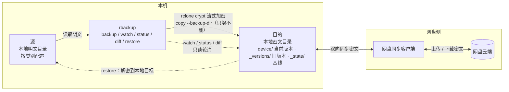

# rbackup · 概念与模型

> 属于 [rbackup 文档](../README.md) 的一章。

## 1. 工作模型



图里只有四条关键关系：

1. **源 → 目的**：rbackup 调用 `rclone copy`，crypt remote 在写入时完成加密，不落地中间明文或临时密文。
2. **目的 ↔ 网盘**：完全由网盘客户端负责。rbackup 不直接调用网盘 API，也不关心是哪家网盘。
3. **目的 → rbackup**：`watch` / `status` / `diff` 只读目的，发现变化只报告，不自动处理。
4. **目的 → 源**：唯一的反向路径是 `restore`，必须由人显式触发；没有任何自动合并。

因为目的在本地，rbackup 的读、写、校验都是本地文件系统操作，速度和费用与网盘无关；代价是密文、版本和状态会占用目的所在的磁盘。

### 1.1 目的里的布局

假设 rclone crypt remote `b_crypt` 的底层是 `D:/QuarkSync/rbackup`：

```text
D:/QuarkSync/rbackup/                 # 目的，本地同步目录
├── <device>/
│   ├── documents/                    # 当前版本（密文）
│   └── photos/
├── _versions/
│   └── <device>/
│       └── 20261030T235653Z-a1b2c3/
│           ├── documents/            # 被覆盖的旧文件
│           └── photos/
└── _state/
    └── <device>/
        └── last-run.json             # rclone rcat 写入的基线
```

说明：

- `<device>` 是设备前缀。设备只写自己的 `<device>/`，不同设备互不干扰。
- `<version>` 使用 UTC 时间 `YYYYMMDDTHHMMSSZ-<6位随机>`，同一秒运行也不会冲突。
- 状态放在 `_state/<device>/` 而不是全局 `_state/last-run.json`，是为了遵守“一设备一前缀”，避免两台设备互相覆盖状态。
- `_state` 只记录设备、版本、每类文件数/字节数/摘要，不保存文件清单。
- **目的在本地，所以 `_versions` 和 `_state` 会占用目的所在磁盘。** 这是“目的是本地同步目录”的必然结果；它们会随目的同步到云端。源本身仍然没有密文、索引或镜像。
- 如果严格要求版本“完全不落本地”，只能让 crypt remote 直接指向云端，而不是本地目的目录；那是另一种部署形态，见 [3.2](03-约束与安全.md#32-部署与同步边界)。
- 目的里看到的都是密文名（目录名同样加密）；如何还原成明文、如何按明文路径删除，见 [8.7](07-命令参考.md#87-查看密文对应的明文以及删除目的中的数据)。

### 1.2 三种部署形态

| 形态 | 目的在哪 | 版本与状态 | 适用 |
|---|---|---|---|
| 本机同步目录（推荐） | 本机磁盘 | 随目的上云 | 绝大多数情况 |
| 另一块磁盘 / 另一台机器 | 挂载的本地路径 | 随目的上云 | 想避免本机落密文 |
| crypt remote 直接指向云端 | 云端 | 不落本地 | 本机不能有任何密文 |

前两种形态下，rbackup 能自动识别目的路径并校验；第三种形态下 `b_path` 为空，`_versions` 和 `_state` 直接写在云端，恢复和版本操作照常，但每次都要走网络。
